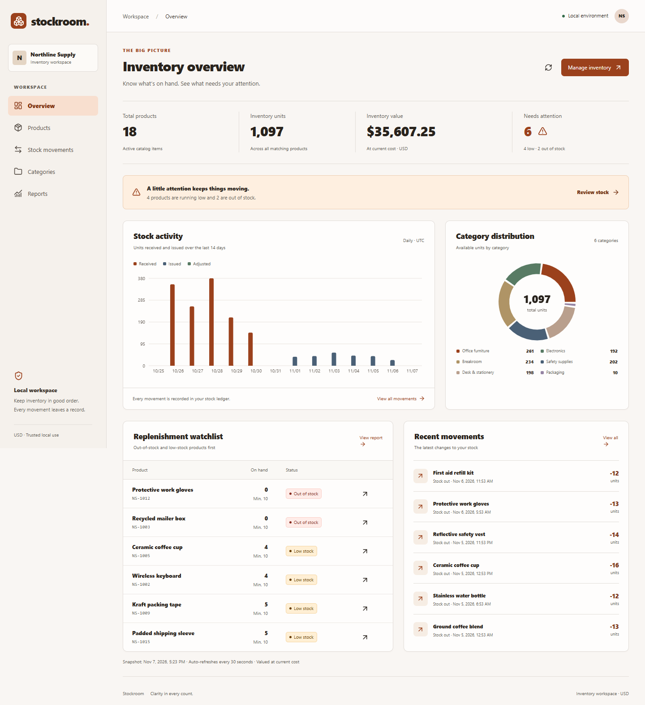
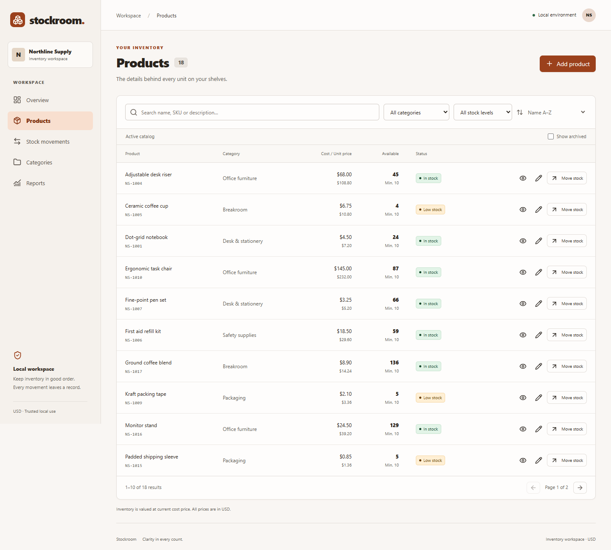
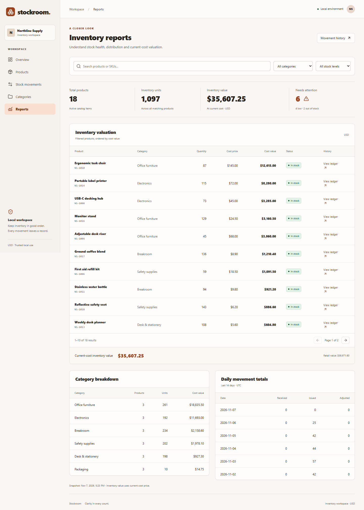

# Stockroom · Inventory Management System

A practical inventory workspace for **Auspify Technologies Software Development Internship, Task 3**. Manage products, receive and issue stock, reconcile counts and understand inventory health through a responsive dashboard.

[Repository](https://github.com/Jaclyn25/inventory-management-system) · [Validation workflow](https://github.com/Jaclyn25/inventory-management-system/actions/workflows/ci.yml) · [API guide](docs/api.md) · [Submission package](submission/PROJECT-SUMMARY.md)



## Features

- **Catalog:** product creation, detail, editing and zero-stock archive; normalized unique SKUs; descriptions; categories; unit/cost prices; stock thresholds; search, filtering, sorting and pagination.
- **Stock:** receipts, withdrawals and counted-quantity adjustments; required reasons; atomic updates; duplicate-operation protection; UUID idempotency keys; UTC timestamps; immutable, searchable movement history.
- **Reports:** inventory summary, low/out-of-stock products, exact current-cost valuation, retail value, category distribution and daily movement totals.
- **Dashboard:** product and unit totals, inventory value, alerts, replenishment watchlist, recent movements and useful charts.
- **Workspace:** responsive navigation, accessible native dialogs, labeled forms, clear stock states, loading/empty/error feedback and success notifications.

## Start on Windows 11 with Docker

Install Git and Docker Desktop, enable Linux containers, and start the Docker engine. No local .NET or Node installation is needed for this path.

```powershell
git clone https://github.com/Jaclyn25/inventory-management-system.git
cd inventory-management-system
powershell -NoProfile -ExecutionPolicy Bypass -File .\scripts\init-env.ps1
docker compose up --build --detach --wait --wait-timeout 180
docker compose ps
```

Open **[Stockroom at localhost:18081](http://127.0.0.1:18081)**. The script generates a local secret in ignored `.env` and preserves existing configuration. First-time image/package downloads can take several minutes; the health-check timeout applies after images are built.

Compose applies EF migrations and seeds an empty database with **18 fictional products, six categories and 36 reconciling movements**. Existing data is preserved. Web traffic uses Nginx, the API is internal, and PostgreSQL is bound to loopback port **54330**. The named `stockroom-data` volume persists data.

`docker compose stop` stops the app. `docker compose down` removes its containers and network while preserving data. Do not remove its volume unless you intend to erase the inventory.

For Linux/macOS, copy `.env.example` to `.env`, set a strong random `POSTGRES_PASSWORD`, then use the same Compose command. [Detailed setup and troubleshooting](docs/setup.md).

## Security model

**Trusted local use only. Authentication and authorization are not implemented. Do not deploy this application publicly without authentication, role-based permissions, HTTPS, restricted database credentials, CSRF/origin review, rate limiting, operational monitoring and backup/restore procedures.**

Compose binds published ports to `127.0.0.1`; the API runs as a non-root user. Secrets are excluded from Git and Docker build contexts. There is no automatic production deployment or internship submission.

## Technology and architecture

| Layer | Technologies |
| --- | --- |
| API | ASP.NET Core 10, C#, EF Core 10, Npgsql, OpenAPI, JSON structured logging |
| Database | PostgreSQL 17, migrations, unique/check/FK constraints, row and transaction locks |
| Frontend | React 19, TypeScript 5.9, Vite 7, Tailwind CSS 4 |
| State, forms, charts | TanStack Query 5, React Hook Form 7, Zod 4, Recharts 3 |
| Testing | xUnit, real PostgreSQL integration tests, Vitest, React Testing Library, Playwright |
| Delivery | Docker Compose, Nginx 1.30, GitHub Actions; no deployment job |

Controllers route validated DTOs to scoped business services. EF Core owns persistence. Stock writes lock the product row inside a transaction and commit its quantity/version and movement together. Idempotency keys serialize retries, and unique business operation IDs reject duplicate work across products. Database triggers reject movement edits and deletion. Reports use repeatable-read snapshots.

Money uses C# `decimal` and PostgreSQL `numeric(14,2)`, with at most two decimal places. The API returns decimal text; the frontend formats it without floating-point money arithmetic. Inventory value is the sum of **current quantity × current cost price**, in USD. [Architecture and concurrency details](docs/architecture.md).

## Native development and tests

Requires .NET SDK 10, Node **22.13+ or 24 LTS**, and a running PostgreSQL server. Node 24 LTS is recommended for development. Exact frontend dependencies are locked in `frontend/package-lock.json`; .NET versions are in project files.

```powershell
pwsh ./scripts/init-env.ps1
docker compose up -d db
dotnet tool restore
dotnet restore
pwsh ./scripts/start-api.ps1
```

In another terminal:

```powershell
cd frontend
npm ci
npm run dev
```

Open **[localhost:5174](http://127.0.0.1:5174)**. The native API is **[localhost:5081](http://127.0.0.1:5081/api/health)**. Native helper scripts read `.env`; tests create and drop uniquely named databases and require CREATEDB permission.

```powershell
pwsh ./scripts/test.ps1
npm --prefix frontend run build
npm --prefix frontend run lint
npm --prefix frontend test
cd frontend
npx playwright install chromium
npm run test:e2e
```

Playwright requires the native API running and starts Vite if needed. To test the Docker app, set `$env:E2E_BASE_URL='http://127.0.0.1:18081'` first. An installed Edge browser can be used locally with `$env:PLAYWRIGHT_CHANNEL='msedge'`.

**Verified:** 35 backend tests, 12 frontend tests and three browser flows pass. CI also builds and starts Docker, checks the reverse proxy and reconciles summary/category totals. [Test coverage and commands](docs/testing.md) · [Actual verification evidence](submission/TEST-RESULTS.md).

## API

OpenAPI: **[/openapi/v1.json](http://127.0.0.1:18081/openapi/v1.json)**. Main resources: `/api/products`, `/api/categories`, `/api/stock/in`, `/api/stock/out`, `/api/stock/adjustment`, `/api/stock/movements`, `/api/reports` and `/api/health`.

Stock writes require a nonempty UUID `Idempotency-Key` header and a distinct UUID `operationId` in the body. Repeating the same key and canonical payload replays its original success. Reusing a key with changed input or repeating an operation ID under another key returns `409`. Adjustments require the current product version. [Request examples and errors](docs/api.md).

## Screenshots

All images below were captured from the running application using fictional records.

| Products | Reports |
| --- | --- |
|  |  |

[Categories](docs/screenshots/categories.png) · [Movement history](docs/screenshots/movements.png) · [Stock dialog](docs/screenshots/stock-operation.png) · [Mobile](docs/screenshots/mobile.png). Reproduce captures using `frontend/scripts/preview.mjs` against a seeded running app.

## Delivery and limitations

Features were delivered in independent branches and PRs from synchronized `main`, with review and passing checks before merge. The existing empty remote required one empty baseline commit. No repository was created, visibility was preserved, and `main` was never force-pushed. [Git delivery record](submission/DELIVERY.md).

The task described the repository as private, but GitHub reported `visibility: public` during final verification. No visibility change was made; this discrepancy remains for the owner to resolve.

- Local trusted operation only; no authentication, public hosting or portal submission.
- Whole-number units, one currency (USD) and one inventory location.
- Current-cost valuation; FIFO/LIFO and historical accounting valuation are outside scope.
- Archive requires zero stock and has no restore UI. Categories referenced by active or archived products cannot be deleted.
- Category lists are unpaginated. Substring search suits this project size; larger catalogs need additional search indexing and operational tuning.
- Report summary and paged detail requests have separate snapshots. Refresh to reconcile changes made while viewing.
- Pending stock retry identity is retained while its dialog remains open; browser reload/offline recovery is not a durable queue.
- Accessibility uses semantic controls, labels, focus and chart alternatives; no claim of formal WCAG certification is made.

The [submission package](submission/PROJECT-SUMMARY.md) includes the project summary, setup, feature checklist, actual screenshots, test evidence and delivery record. A source ZIP can be produced with the documented packaging script. Nothing is submitted automatically.
