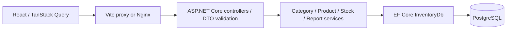
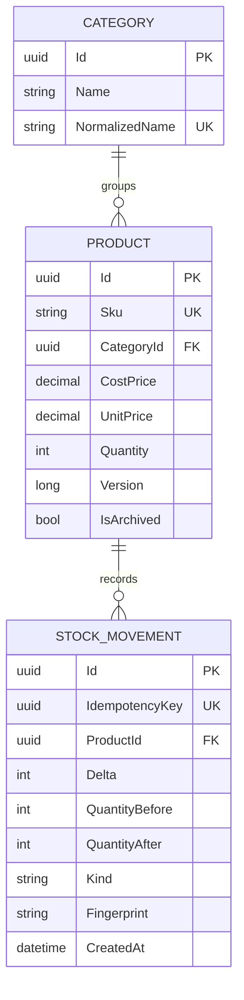

# Architecture and business invariants

## Boundaries

Controllers handle transport and validation. Services own business rules and transaction boundaries. The DbContext defines relational constraints. No extra repository, event bus or distributed service layer is needed for this scope. React pages use shared forms, error/status components and query invalidation after successful changes. Dashboard and report routes load chart code separately.

## Data model

SKU and category names are normalized for unique comparison. Product quantities and thresholds are bounded from zero to 1,000,000,000. Prices range from zero to 999,999,999.99. Database checks enforce quantity, money, SKU, archive and movement invariants; restrictive foreign keys preserve referenced categories/products. Indexes support SKU uniqueness, active catalog ordering, category membership, movement timestamps and per-product history.

## Stock mutation protocol

1. Validate the operation UUID, product UUID, key, quantity and reason.
2. Begin a PostgreSQL transaction and acquire a transaction-scoped advisory lock derived from the idempotency key. Hash collisions cause extra serialization, not incorrect writes.
3. Look up an existing movement by key. An identical canonical fingerprint returns the original movement. A changed request returns `409`.
4. Select the product with `FOR UPDATE`. PostgreSQL serializes writers to that product, including concurrent receipts and withdrawals.
5. Reject archived products, insufficient stock and unsupported totals. An adjustment also compares the reviewed product version, then calculates counted quantity minus current quantity. Zero-delta adjustments are rejected.
6. Update quantity and version and insert the movement in one SaveChanges/transaction commit. A duplicate business operation UUID or any failed insert rolls back the quantity change.

The idempotency fingerprint includes kind, operation/product IDs, quantity, trimmed reason and adjustment version. The operation ID is globally unique, even across different products. Failed operations create no movement. Same-key retries return `200` and preserve the original balances and timestamp rather than reporting a newer product balance.

Movement rows capture the SKU, product name and cost at the time of the change. PostgreSQL rejects UPDATE and DELETE on the ledger with a trigger. API routes provide no history mutation. Database administrators can still alter schema/disable triggers; this is not a tamper-proof external audit service.

Catalog edits use an optimistic version token and never accept stock quantity. Archive uses a conditional update requiring active, current-version, zero-stock state. Stock changes increment the same version, protecting edits/counts from concurrent changes.

## Valuation and reporting

Money is `decimal` in C# and `numeric(14,2)` in PostgreSQL. Input precision beyond two decimals is rejected before storage. Decimal values cross the JSON boundary as invariant text; client formatting uses BigInt for whole-number grouping. The browser does not multiply or sum money.

Inventory value uses current cost, and retail value uses current unit price. A cost edit revalues current units while leaving historical movement cost unchanged. This is an operational valuation model, not FIFO/LIFO accounting.

Summary counts, unit totals, values, category distribution, attention products, recent movement selection and daily activity share a repeatable-read transaction. Product/history pages also snapshot count and result rows together. Independent HTTP summary and detail requests may represent different instants during concurrent activity.

All stored timestamps are UTC. Movement creation uses PostgreSQL-compatible microsecond precision for stable replay responses. Date filters use UTC; displayed dates use the viewer's local timezone. Fictional seed insertion is transactionally guarded, runs only when catalog/categories are empty and reconciles every quantity to ledger deltas.

## Security and operations

There is no identity or permission system. Loopback Compose bindings are a local-use boundary, not authentication. The API container uses the .NET non-root user; database credentials are generated into ignored `.env`. Nginx adds a same-origin CSP, frame denial, MIME protection and referrer policy. Logs are structured JSON without sensitive-data logging. Unexpected errors produce sanitized problems with trace IDs.

Before public deployment: implement authentication/authorization, HTTPS, origin/CSRF controls appropriate to the chosen auth model, rate limiting, least-privilege runtime/migration DB roles, safe migration orchestration, monitoring, dependency/image maintenance, backups and tested recovery. CI has no deployment job.
